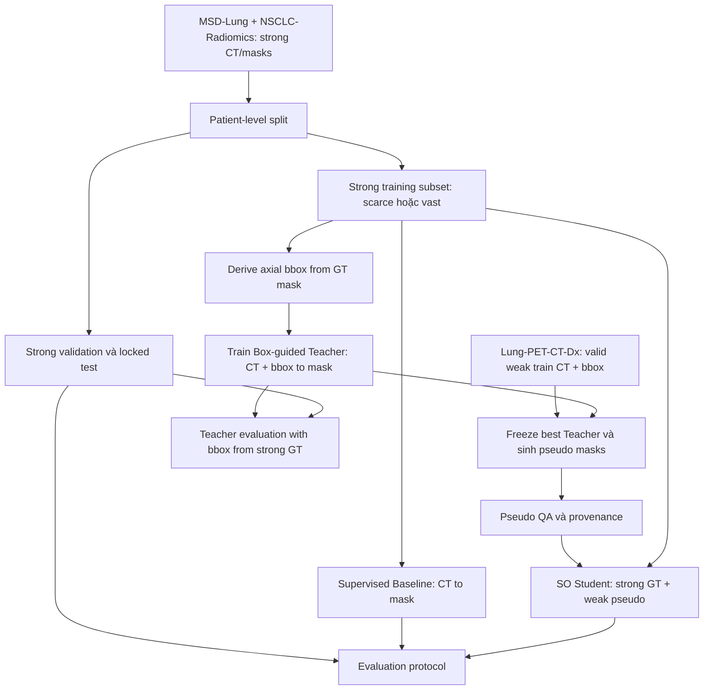

# SE374.R11 — Project handoff cho Codex

**Đề tài:** Lung Tumor Segmentation from CT Images Using a Mixed-Supervision Teacher–Student Framework  
**Phiên bản:** 2.1 — Technical handoff, 24/11/2026  
**Kế thừa:** Kế hoạch v2.0 ngày 20/11/2026; phản hồi giảng viên; các trao đổi về paper, dataset, checkpoint và bước triển khai đầu tiên.  
**Trạng thái xác nhận:** Đã thống nhất hướng và kế hoạch; chưa có bằng chứng repository của nhóm, dataset đã tải, code đã chạy hoặc kết quả training. Bắt đầu ở P0.  
**Đối tượng đọc:** Codex và hai thành viên nhóm. TV1/TV2 là vai trò đề xuất, không phải tên người.  
**Ngôn ngữ:** tài liệu/báo cáo tiếng Việt, mã nguồn và định danh kỹ thuật tiếng Anh.

> **Chỉ thị triển khai:** Đây là kế hoạch tổng thể, không phải yêu cầu thực hiện đồng loạt mọi phase. Trong lần triển khai đầu tiên, chỉ thực hiện P0 (T01–T03), kiểm tra kết quả và báo cáo bằng chứng. Giữ nguyên định hướng sử dụng cả ba dataset. Không tự động thu hẹp phạm vi, chạy huấn luyện lớn, sửa dữ liệu gốc, dùng test để tune hay công bố kết quả chưa đo.

## 0. Cách sử dụng tài liệu

- Đọc toàn bộ để hiểu mục tiêu, dependencies và các ràng buộc trước khi chỉnh code. Kiểm tra repository làm việc hiện tại, `AGENTS.md`, README, git status và các phần đã có; không ghi đè công việc của người dùng.
- Phân biệt **[Paper]** (nội dung tác giả công bố), **[Repo gốc]** (những gì kiểm tra được trong code), **[Đã chốt]** (quyết định của nhóm / feedback thầy), **[Đề xuất]** (thiết kế thực thi cần xác nhận bằng code/test) và **[Cần xác minh]** (không suy đoán thành sự thật).
- Khi paper và code khác nhau, lập bảng đối chiếu có đường dẫn và dòng code/commit; ưu tiên phương pháp nghiên cứu đã chốt, ghi rõ sai lệch. Nếu thiếu thông tin quyết định, tạo mục OPEN trong tài liệu, đề xuất giải pháp và lý do; không âm thầm thay đổi phương pháp.
- Các đường dẫn trong tài liệu là layout mục tiêu, có thể thích nghi với repo hiện có. Các lệnh CLI là giao diện đề xuất, chưa phải lệnh đã chạy thành công. T01–T24, E01–E08 là định danh ổn định.

## 1. Bối cảnh và các quyết định đã thống nhất

Đồ án môn học SE374.R11 thuộc Topic 5: Tumor Segmentation using CT/fMRI. Phạm vi thực tế là phân đoạn **khối u phổi nguyên phát trên CT 3D**, không nghiên cứu fMRI, không dùng PET làm đầu vào mô hình. Bài toán nghiên cứu: giảm phụ thuộc vào segmentation masks tốn công gán nhãn bằng cách tận dụng dữ liệu chỉ có bounding box. Student cuối cùng phải nhận CT và xuất mask 3D, không cần bbox do người dùng cung cấp.

Bài báo nền tảng: Fredriksen V., Sevle S.O.M., Pedersen A., Langø T., Kiss G., Lindseth F. (2022), *Teacher-student approach for lung tumor segmentation from mixed-supervised datasets*, PLOS ONE 17(4):e0266147, công bố 05/04/2022. DOI: https://doi.org/10.1371/journal.pone.0266147. Repository: https://github.com/VemundFredriksen/LungTumorMask.

### 1.1. Feedback giảng viên (email nhóm cung cấp)

| Ý kiến của thầy | Hệ quả triển khai |
|---|---|
| Đề tài phù hợp; quan trọng là tạo pseudo masks hiệu quả từ bbox | Box-guided Teacher và QA nhãn giả là trọng tâm, không chỉ xây một U-Net |
| Student học thêm từ pseudo masks để improve performance | Phải có đối chứng supervised-only và đo chênh lệch cùng tập test; không bảo đảm trước kết quả tăng |
| Có thể chạy nhiều phiên và resume checkpoint | Xây cơ chế lưu/khôi phục đầy đủ, kiểm chứng bằng thử nghiệm gián đoạn |
| Setting baseline và proposed method phải giống nhau | Cố định dữ liệu đánh giá, kiến trúc SO, quy tắc huấn luyện/đánh giá, ghi ngân sách cập nhật và tài nguyên |
| Đồ án chỉ cần kết quả trên một bộ dataset cũng được | Đây là phương án dự phòng được phép, không phải yêu cầu bỏ hai dataset còn lại |

### 1.2. Quyết định của nhóm sau feedback

1. **Phương án A (mặc định): cả ba dataset** MSD-Lung, NSCLC-Radiomics, Lung-PET-CT-Dx theo thiết kế mixed supervision của paper.
2. Ưu tiên chạy kịch bản Scarce trước để có kết quả E01/E02/E03; tiếp tục Vast E04/E05/E06. DO Student, point-guided Teacher và ablation là mở rộng khi có tài nguyên.
3. Dùng Kaggle GPU dự kiến; điều chỉnh thiết lập nếu không phù hợp VRAM hoặc hạn mức. Ghi lại mọi khác biệt, không tuyên bố tái hiện nguyên bản khi đã thay đổi.
4. Nếu gặp trở ngại, cắt phần mở rộng → tối ưu GPU và training budget, vẫn giữ 3 dataset → ưu tiên Scarce → chỉ chuyển một dataset khi nhóm đồng ý dựa trên bằng chứng. Không tự động fallback do một lỗi cài đặt.
5. Sản phẩm chính là nghiên cứu thực nghiệm tái lập được; web app, mobile app, tích hợp bệnh viện và chẩn đoán lâm sàng không thuộc MVP. Demo CT-only là minh họa kỹ thuật, không dùng cho quyết định y tế.

## 2. Phương pháp phải tái hiện

### 2.1. Thuật ngữ và pipeline

- Strong annotation: mask 3D xác định voxel thuộc khối u; dùng làm GT (ground truth).
- Weak annotation: bounding boxes **2D trên axial slices**, không mặc định là một cuboid 3D duy nhất. Bbox có mô nền bên trong, không tương đương mask thật.
- Pseudo mask: mask do Teacher dự đoán từ CT + bbox, có thể sai; không gọi là GT chuyên gia.
- Baseline: mô hình SO segmentation học chỉ từ strong train. Teacher: mô hình có hướng dẫn bbox. Student: mô hình automatic CT-only, học thêm pseudo labels.



[Paper] Algorithm 1: (1) từ strong GT tạo weak annotation để Teacher học CT + weak annotation → strong GT; (2) dùng Teacher đã huấn luyện sinh pseudo masks cho weak data; (3) huấn luyện Student trên hợp của strong data và pseudo-annotated data. Không sử dụng Teacher hay bbox tại inference của SO Student. Cần kiểm tra pseudocode với prose khi ký hiệu không nhất quán; không sao chép lỗi ký hiệu vào pipeline.

### 2.2. Tham số paper và khác biệt source code

| Hạng mục | [Paper] | Yêu cầu triển khai |
|---|---|---|
| CT intensity | Clip HU [-1024, 1000] rồi Z-score | Xác minh phạm vi tính mean/std; không dùng thống kê test toàn tập để fit preprocessing |
| Spacing | 1 × 1 × 1.5 mm | Ghi trục vật lý và quy ước tensor; CT nội suy liên tục, nhãn rời rạc nearest-neighbor |
| Teacher crop | 128 × 128 × 128 voxel quanh u | Tâm crop dựa vào bbox hợp lệ; ghi pad/crop và phục hồi đúng không gian |
| Student crop | Tách thành hai vùng phổi, dùng lungmask hỗ trợ | Cùng pipeline cho baseline/SO; không dùng GT tumor để chọn ROI tại inference |
| Teacher | U-Net-like 3D, 3 lần downsampling (128 → 16) | Xác thực Fig. 2 và source về channel, filter, blocks |
| Student | 4 lần downsampling; stride-2 convolution và PReLU | SO một đầu ra segmentation, DO thêm decoder bbox; baseline kiến trúc SO |
| Optimizer | Adam, LR 1e-4 | Config paper reference, thay đổi chỉ có log |
| Batch | 1, gradient accumulation 8 | Ghi effective batch và optimizer steps |
| Loss | Dice Loss | Xác minh activation, reduction, smooth, empty cases; DO thêm loss bbox |
| Training | Tối đa 350 epochs hoặc overfit; chọn thấp nhất validation loss | Paper không cho mọi chi tiết patience/scheduler; đề xuất phải ghi riêng |
| Môi trường gốc | Python 3.7, MONAI 0.4.0, PyTorch 1.6, CUDA 11.0 | Không ép cài legacy trên Kaggle nếu không tương thích; pin phiên bản thực chạy |
| GPU gốc | 2 RTX 8000 48 GB; Student đỉnh khoảng 22.54 GB; inference khoảng 3 GB | Profile GPU thực tế; không suy ra 2 GPU 16GB tự động gộp thành 32GB |

[Repo gốc — đã đối chiếu sơ bộ] `training/Resources/Student_Train/train.yaml` có `architecture: UNet4`, `filter_base: 32`, `filter_expansion: 2`, `scale_dim: 256,256,128`, Adam LR `0.000025`, `max_epochs: 500`, `output_threshold: 0.5`. Đây là config trong repo, **không xác nhận là exact config của thí nghiệm paper**. README còn có test YAML nhỏ 3 epochs, LR 0.001 và đường dẫn Windows. Không nhầm các ví dụ này với paper. Ghi riêng `paper_reference`, `repo_reference`, `resolved_runtime_config`.

### 2.3. Các file nguồn cần đọc ở P0

| Đường dẫn trong LungTumorMask | Điều cần đối chiếu |
|---|---|
| `training/README.md`, `setup.py`, `Resources/requirements.txt` | Entry points, dependency, đường dẫn hardcode |
| `training/Networks/network.py` | Model registry và mapping tên architecture |
| `training/Networks/UNet4.py`, `UNet5_Teacher.py`, `UNet5_decoder_teacher.py`, `UNet5_filter_teacher.py`, `UNet_concat_double_student.py`, `monai_student.py`, `monai_unet.py` | Xác định biến thể thật, không suy diễn vai trò chỉ từ tên file; tensor shapes, blocks, activation |
| `training/Engine/train.py`, `evaluate.py`, `inference.py`, `utils.py` | Loss, loader, optimizer updates, saving/resume, inference, metric |
| `training/Utils/`, `training/Runable/Train/`, `Runable/Inference/`, `Runable/Evaluate/` | Data transforms, scripts và pseudo-generation nếu có |
| `training/Resources/Student_Train/{train.yaml,data.yaml,data_test.yaml}` | Candidate split và sample config; truy vết dữ liệu thật |
| `training/Resources/Idun_Train_1/`, `Idun_Train_2/`, `Evaluate/`, `Inference/` | Các biến thể config/split và khác biệt |

Nguồn trên đã được khảo sát ở mức tên file, README và một số YAML/entry point; P0 phải đọc thân code, ghi commit SHA và mức độ xác minh. Không mặc định repo cung cấp toàn bộ raw-data conversion, split gốc hoặc resume hoàn chỉnh. Không dùng pretrained model tác giả cho baseline hoặc Student scratch-training nếu không thiết kế đối chứng riêng; inference tham chiếu chỉ để sanity check, có ghi rõ nguồn weights.

## 3. Dữ liệu: ba dataset và kiểm soát rò rỉ

### 3.1. Vai trò

| Dataset | Số lượng trong paper | Nhãn | Vai trò |
|---|---:|---|---|
| MSD-Lung (Task06_Lung) | 64 CT có nhãn | Strong mask | Strong train/val/test, đánh giá segmentation |
| NSCLC-Radiomics | 422 CT | Strong mask | Strong train/val/test, đánh giá segmentation |
| Lung-PET-CT-Dx | 1.295 ảnh ban đầu → 665 sau lọc | Weak axial bbox | Weak train để sinh pseudo; nếu có weak val/test chỉ dùng cho nhiệm vụ có nhãn phù hợp, không tính Dice GT |

Số ảnh/series khác số bệnh nhân. Con số của nhóm có thể khác bản tải của tác giả. MSD test chính thức không có mask public thì không dùng làm test Dice local; chia từ các ca có nhãn. NSCLC-Radiomics cần kiểm tra DICOM/RTSTRUCT và định danh cấu trúc khối u; Lung-PET-CT-Dx cần kiểm tra file bbox gắn đúng slice/series, class cần dùng. Tuân thủ license/điều kiện chia sẻ, không công khai dữ liệu hoặc thông tin bệnh nhân trái điều kiện sử dụng.

[Paper] Lung-PET-CT-Dx loại PET, PET/CT fused, scan chỉ có một phần nhỏ thorax hoặc ghép nhiều scan; lọc CT có chiều dài vật lý trục Z ngoài [16,60] cm. Codex phải xác minh cách tính extent (slice positions/spacing, không nhầm voxel count với cm), quy tắc phát hiện scan ghép, scan trùng, bbox thiếu. Không cố ép số cuối bằng 665 bằng cách loại tùy tiện.

### 3.2. Thu thập và manifest

- MSD: lấy CT và label NIfTI, kiểm tra dataset metadata và mapping nhãn.
- NSCLC: dùng CT series đúng tham chiếu của RTSTRUCT, nếu cần rasterize contour vào đúng lưới CT; quy tắc chọn primary tumor/GTV phải được xác minh và ghi log. Không mặc định mọi ROI là tumor.
- Lung-PET-CT-Dx: chỉ lấy CT hợp lệ và bbox đúng CT; kiểm tra định dạng annotation thực tải (không tự giả định XML/JSON), tọa độ pixel/physical, UID hoặc mapping slice; không train PET.
- Lập `data_inventory.csv`, `manifest_msd.csv`, `manifest_nsclc.csv`, `manifest_weak.csv`, `data_manifest.csv`, `exclusion_log.csv` và data card riêng từng dataset. Raw read-only, không sửa nguồn; bước chuyển đổi phải chạy lại được.

[Đề xuất] Schema manifest tối thiểu (CSV/JSONL có data dictionary):

```text
case_id, dataset, patient_id, study_uid, series_uid, modality,
image_path, annotation_kind, mask_path, bbox_path, bbox_count,
shape, spacing_mm, orientation, affine_hash, extent_z_mm,
source_version, file_hash, split, qc_status, exclusion_reason
```

`case_id` duy nhất; patient key có namespace dataset; đối chiếu cross-dataset duplication qua metadata/hashes khi khả thi. Không lưu định danh nhạy cảm vào Git; pseudo-ID nhất quán. Field không áp dụng để null chứ không giả mask. Metadata vector/affine lưu JSON sidecar hoặc quy ước CSV rõ ràng. Exclusion log: dataset, ID, stage, reason code, evidence, revision.

### 3.3. Split và hai kịch bản

[Paper] Test 15%, cùng split cho mọi thí nghiệm, nhóm scan theo bệnh nhân, upsample tumor size hiếm trong train/validation. Paper mô tả Vast khoảng 500 strong/750 weak và Scarce khoảng 50 strong/1.000 weak; phần Discussion nói một model học từ 40 ảnh human-annotated. Các số này **không phải danh sách ID chính xác hay số train bắt buộc**, và số weak 665 sau lọc không khớp trực tiếp các số xấp xỉ kịch bản nếu chỉ đếm scan duy nhất. Cần làm rõ đơn vị đếm, crop, sampling, split và cách tạo scarce weak pool qua T01/T07. Không tự tuyên bố rằng tác giả chuyển toàn bộ strong còn lại thành weak nếu chưa có bằng chứng.

[Đã chốt theo v2.0] Nếu không tái dựng exact split, chọn split tái lập do nhóm định nghĩa: giữ test xấp xỉ 15% ở cấp patient, stratify theo nguồn và kích thước tumor khi khả thi; chia train/val từ phần còn lại theo tỷ lệ chốt trước training; dùng cùng weak train hợp lệ cho Vast/Scarce; Scarce là subset của strong train (mốc đề xuất khoảng 40 ảnh, ưu tiên group theo patient và cân bằng nguồn). Strong train không dùng trong scarce được giữ ngoài training mặc định; chỉ chuyển sang simulated weak ở **thí nghiệm riêng** nếu có căn cứ/được duyệt, tuyệt đối không dùng mask thật cho học weak. Ghi rõ đây là adapted protocol nếu khác paper. Validation/test strong dùng chung giữa baseline và student; có thể dùng cùng giữa hai kịch bản để đối chiếu. Nếu nghiên cứu scarcity gồm ngân sách nhãn val thì phải ghi rõ số nhãn val, không gọi đó là exact paper setting.

- Freeze `train_ids.csv`, `val_ids.csv`, `test_ids.csv`, `scarce_train_ids.csv`, `weak_train_ids.csv` (hoặc format tương đương) cùng seed, split version/hash và số patient/scan. Chia trước khi crop, augmentation, oversampling và pseudo-generation.
- Kiểm tra intersection theo patient, case và duplicate scan (cross dataset nếu có căn cứ), subset relation, label availability. Không đưa weak test/val vào pseudo train. Không sinh pseudo từ strong test để bổ sung training.
- Không dùng test để chọn ngưỡng, early stopping, filter pseudo, kiến trúc hoặc tuning. Test manifest được khóa ngay P1; nếu phát hiện lỗi nghiêm trọng, đổi version, ghi lý do, chạy lại tất cả cặp đối chứng liên quan.

## 4. Hợp đồng preprocessing, spatial QA và dataset loader

[Đề xuất triển khai chi tiết; không phải mọi quy tắc được paper mô tả đầy đủ.]

1. Đọc volume, preserve origin/direction/spacing/affine; xác nhận HU slope/intercept cho DICOM; sắp slice theo hình học, không theo tên file. Đánh dấu orientation chuẩn (ví dụ RAS/LPS) và mapping array (x,y,z) vs PyTorch (D,H,W). Test affine với synthetic coordinate.
2. Clip HU và Z-score theo phương pháp đã xác minh; ghi mean/std, epsilon xử lý volume hằng. Resample CT liên tục, mask/bbox raster dùng nearest-neighbor hoặc transform tọa độ và rasterize theo convention được xác minh. Không dùng interpolation tuyến tính cho label ID.
3. Strong axial bbox từ từng slice có GT: lấy min/max pixel foreground theo object/primary tumor policy, thống nhất quy ước inclusive/exclusive; kiểm tra mọi foreground trong bbox. Weak bbox phải map từ đúng slice về transformed grid, không kéo dài bbox qua slice trống thiếu annotation nếu chưa xác minh. Giữ semantics missing vs negative.
4. Teacher crop quanh bbox, shape 128³ ưu tiên paper; kiểm tra vùng u không bị cắt, padding an toàn, nhiều lesion/box được xử lý theo policy explicit. Lưu crop metadata và khả năng reconstruct mask về full volume.
5. Student/baseline: lungmask xác định phổi trái/phải; crop/resize/pad theo resolved config, có margin/failure policy nếu lungmask bỏ sót tumor. QA strong chỉ để kiểm tra/điều chỉnh trên train/val, không dùng GT test để cứu crop. Inference CT-only xử lý hai phổi, inverse transform và merge theo quy tắc cố định. Kiểm tra ca khối u sát ranh giới phổi, nhiều lesion và khối u lớn.
6. Cache deterministic preprocessing trước augmentation; cache key gồm source hash, preprocess config/version, tránh tái dùng stale output. Dữ liệu masks nhị phân 0/1 (trừ trường hợp label khác đã được map rõ). Lưu original/transformed geometry, crop bounds, padding và inverse metadata. Không overwrite raw.
7. Augmentation chỉ train, spatial transform áp đồng bộ CT/mask/bbox. Nếu intensity transform chỉ áp CT, ghi chính sách. Tumor size balancing và sampler xác minh ở P0; nếu upsample validation theo paper, ghi thêm metric trên unique validation cases để tránh sai cách tính; test không oversample.

Giao diện tensor đề xuất: CT `float32 [C,D,H,W]` với C=1; GT/pseudo `binary [1,D,H,W]`; Teacher `bbox` cùng lưới với CT (số channel và cách kết hợp phải xác minh); batch `[N,C,D,H,W]`. Mỗi sample kèm case ID, source, label type và transform metadata. Không hardcode shape khi đã có config; fail sớm nếu lệch shape/affine. DO target bbox và loss auxiliary riêng (P5).

**QA P1:** inventory thật; overlay tối thiểu 10–20 ca tổng và 5–10 ca ngẫu nhiên mỗi nguồn khi đủ ca, ưu tiên lát axial/coronal/sagittal và tumor extremes; ghi sample IDs, lỗi và cách sửa. Kiểm tra 1 batch teacher/baseline/student bằng forward, loss, backward (giai đoạn này có thể dùng mẫu pipeline hợp lệ hoặc pseudo fixture gắn nhãn synthetic, không phải dữ liệu thực nghiệm). Không train quy mô lớn trước Gate A.

## 5. Mô hình, training, pseudo mask

### 5.1. Baseline (E01/E04)

CT-only SO architecture; strong GT-only; cùng pipeline Student inference, Dice Loss, training loop, initialization policy và evaluation. Baseline không dùng weak images, pseudo masks hoặc bbox inputs; có thể dùng tumor masks train để sampling nếu cùng chính sách strong-data với SO. Bắt đầu E01 scarce. Kiểm tra overfit tiny synthetic/real train subset, finite loss và prediction shape trước full run.

### 5.2. Teacher box-guided (E02/E05)

Strong train CT + bbox suy từ GT → segmentation target là GT. Point-guided Teacher (chỉ định vị bằng điểm) là optional ablation theo paper. Teacher khác Student về crop và độ sâu; không ép Teacher cùng kiến trúc SO. [Cần xác minh] mã hóa bbox bằng channel riêng hay cơ chế khác, crop point vs bbox, normalization, logits/activation, chính xác loss và filtering. Chỉ sử dụng bbox suy từ GT strong val/test để **đánh giá Teacher có điều kiện bbox**, không nhầm với fully automatic Student. Freeze best validation checkpoint trước sinh pseudo; mỗi scenario dùng Teacher tương ứng, không reuse Vast Teacher trong Scarce (sẽ làm rò strong-label budget).

### 5.3. Pseudo-label generation + quality gate (T14–T15)

- Load best Teacher + config hash, `eval()` + no grad. Chỉ chạy `weak_train_ids`, có bbox hợp lệ. Lưu per-case probability nếu dung lượng cho phép, binary pseudo mask, bbox, confidence proxy, geometry/transform và trạng thái. Threshold 0.5 là config repo tham khảo; chốt trên validation trước run, không xem test để chọn. Lưu riêng pseudo_raw và pseudo_filtered nếu thử postprocess.
- Map crop output về CT full volume rồi áp student transforms phù hợp; nếu nhiều crop/object, merge có quy tắc và kiểm tra. Không gán bbox đầy 1 làm pseudo mask mặc định; không âm thầm clip/remove components nếu chưa có thiết kế. Có thể thử bbox constraint/CC filtering trong E08, ghi là cải tiến nếu không có bằng chứng paper dùng.
- Chạy idempotent theo case, lưu manifest chỉ sau output hợp lệ; có thể resume job sinh pseudo mà không tính lại case đã thành công. Invalid/quarantined cases không tự đi vào Student train. Không trộn teacher weights khác giữa các case cùng run.

```text
pseudo_manifest.csv:
case_id, dataset, patient_id, split, scenario, image_path, bbox_path,
pseudo_path, probability_path, teacher_run_id, teacher_checkpoint_hash,
preprocess_hash, split_hash, threshold, postprocess_version,
shape, affine_hash, foreground_voxels, qc_status, qc_reason
```

QA tự động: shape/affine đúng, finite, binary values, empty rate, volume mm³, số connected components, foreground outside bbox fraction, bbox coverage/volume ratio và outlier size. Quy tắc empty/unknown bbox phải xác minh theo nhãn thực tế, không coi mọi empty là true negative. QA thủ công bằng montage CT+bbox+pseudo, nhóm theo kích thước/confidence, ca thành công và thất bại (đề xuất ≥10 ca mỗi nhóm lỗi phổ biến nếu đủ). Không giả Dice của weak data nếu không có segmentation GT. Teacher DSC trên strong val và held-out strong test là đối chứng có GT; nếu mô phỏng weak trên strong audit set, giữ audit data khỏi training và ghi riêng.

Gate C: không có lỗi hình học nghiêm trọng chưa giải quyết; đã thống kê coverage/rejection và lý do; ngưỡng QC được chốt trên train/val; có sample overlays; pseudo manifest liên kết đúng teacher, CT, bbox, version; nhóm review chất lượng trước khi train Student. Không đặt target Dice cố định tùy ý để tuyên bố pass/fail khoa học.

### 5.4. SO Student (E03/E06) và DO (E07)

SO học trên `D_strong ∪ D_pseudo`, CT input, 1 segmentation output. Ghi label provenance và sampler ratio strong:pseudo, số batch/source, weighting loss nếu có (cần xác minh paper; không mặc định weighting/confidence). Không cấp bbox channel khi training SO rồi bỏ ở inference. Baseline và SO cùng kiến trúc, cùng init policy, preprocessing và hyperparameters. Student không mặc định khởi tạo từ Teacher; nếu chọn warm start, phải có đối chứng tương ứng và nêu rõ. DO thêm decoder dự đoán axial bbox và auxiliary loss; đánh giá mask branch và thiết kế inference phù hợp. DO chỉ khi SO pair xong. E08 dùng SO raw vs filtered pseudo để đo ảnh hưởng chất lượng nhãn giả; thay một yếu tố, không thay test.

## 6. Checkpoint, Kaggle và công bằng thực nghiệm

### 6.1. Checkpoint contract

"Run nhiều phiên và resume checkpoint" = một run logic qua nhiều session, không phải nhiều run độc lập hoặc ensemble. Ví dụ 20 epochs mỗi phiên, lần sau tiếp tục epoch 21 từ last checkpoint. Giải quyết session timeout/quota, không tự giảm VRAM. Số phiên baseline và Student không cần bằng nhau.

Lưu `last.ckpt` để resume; `best.ckpt` theo cùng validation rule để evaluation. Tối thiểu: schema version, run ID, model state, optimizer state, scheduler state (nếu dùng), AMP GradScaler (nếu dùng), completed epoch, global micro-step và optimizer_step, best val metric/early-stop counter, RNG Python/NumPy/Torch CPU/CUDA, sampler/generator state hoặc policy resume epoch boundary, resolved config/hash, split/preprocess/pseudo hashes, Git revision, dataset versions, logs. Save atomic (temp + replace) và verify readable/hash trước khi export. Ưu tiên save ngay sau optimizer step hoặc epoch boundary; không bỏ gradient accumulation pending mà vẫn báo exact resume. Nếu resume giữa epoch cần cursor/gradient state phù hợp hoặc replay rõ ràng.

Khi resume: khởi tạo đúng model/optimizer/scheduler, load checkpoint từ nguồn tin cậy, map device, restore state và RNG, kiểm tra hash compatibility, bắt đầu đúng step, nối log không trùng dòng; không restart LR, patience, scaler. Nếu config khác ở tham số ảnh hưởng training thì tạo run mới/ghi migration, không silently resume. Checkpoint last/best và log phải ra persistent storage (Kaggle saved notebook output/dataset riêng tư theo license hoặc nơi lưu được phép); xác minh có thể attach và load ở session mới. Không giả định ghi `/kaggle/working` là đã persist nếu session bị ngắt.

**Test bắt buộc:** seed cố định, CPU synthetic (và GPU khi có), chạy 10 optimizer steps liên tục so với 5 + save/load + 5. So sánh global_step, LR, optimizer state, loss/log, model weights với tolerance có lý do, kiểm tra best/last semantics. Nếu hardware/nondeterministic op khiến không bitwise giống, báo tolerance và lý do. Test config mismatch, missing/corrupt file. Không claim CUDA test nếu chỉ chạy CPU.

### 6.2. Kế hoạch tài nguyên

Đo device/VRAM/RAM/disk và hạn mức thực tế từng session, không hardcode quota Kaggle. Profile one-case teacher/student, 20 steps và một epoch đại diện; ghi peak allocated/reserved VRAM, wall-time, seconds/update, IO/cache. Ước lượng runtime từ số updates thực đo. Thử AMP, accumulation, activation checkpointing, cache/workers/IO trước khi đổi kiến trúc. Nếu OOM, giảm patch/filter/capacity có kiểm soát, điều chỉnh baseline/SO đồng nhất; tránh cắt ROI làm mất u. Dùng nhiều GPU chỉ khi đã triển khai distribution đúng; bộ nhớ không tự cộng. Giới hạn runtime bằng safe stop + persisted last ckpt. Không yêu cầu Codex tự chạy GPU cloud/ tải dataset rất lớn nếu chưa có quyền hoặc tài nguyên.

### 6.3. Fair comparison protocol

Trong cùng scenario: cùng strong train IDs, strong validation/test IDs, preprocessing, architecture baseline/SO, loss cơ bản, init/seed policy, augmentation, batch/effective batch, optimizer/LR/scheduler, validation cadence và best-model selection, threshold/inference/metric. Khác biệt chủ đích duy nhất ở cặp chính: SO thêm weak pseudo training samples. Log sampling distribution, optimizer steps, epochs, examples seen, effective batch, wall-time/GPU và chi phí train Teacher/generate pseudo tách riêng. Dùng cùng training budget optimizer updates làm so sánh chính (vì cùng epoch nhưng dataset lớn khác số steps); nếu có tài nguyên, chạy thêm protocol theo paper tối đa 350 epochs/convergence và báo riêng. Chốt rule before training, không chỉ chọn bảng đẹp. Tái chạy cả cặp nếu thay đổi setting ảnh hưởng comparison. Một seed là tối thiểu khả thi, nếu có thêm seed báo mean/variance across seeds tách với variance per-case.

## 7. Metrics và thiết kế thí nghiệm

### 7.1. Định nghĩa và tests

- DSC = 2|P∩G|/(|P|+|G|), đánh giá trên full volume đúng geometry; báo per-case và mean ± SD theo MSD, NSCLC, pooled (ghi weighting). Ghi empty-empty, empty-vs-nonempty policy trước chạy.
- DSC-TP: Dice trên true-positive objects; paper dùng điều kiện overlap ≥25% cho TP. [Cần xác minh] denominator overlap, connectivity, one-to-one vs other matching, cách aggregate DSC-TP. Không tự đồng nhất 25% overlap với IoU 0.25. Nếu code không xác minh được, chốt policy minh bạch, unit tests và ghi khác paper.
- Object-wise F1 = 2PR/(P+R), Precision = TP/(TP+FP), Recall = TP/(TP+FN); F1 theo **đối tượng**, không thay bằng voxel F1 (voxel F1 thường tương đương Dice). Xử lý no predictions, no objects, nhiều lesion, split/merge detections, exact threshold boundary. Đảm bảo matching không double-count theo policy đã chốt.
- Teacher evaluation: DSC với input bbox từ strong GT, tách khỏi automatic results. Weak-only dataset: coverage/QC, không DSC GT giả.
- Unit tests: identical mask, disjoint, partial overlap biết trước, empty both, one empty, multi-object TP/FP/FN, boundary 25%, shape mismatch, inverse crop geometry. Test metrics bằng fixtures có kết quả giải tay. Không tune trên test.

### 7.2. Ma trận thí nghiệm đã chốt v2.0

| ID | Scenario | Model | Training data | Mức ưu tiên |
|---|---|---|---|---|
| E01 | Scarce | Baseline | Strong subset | Cốt lõi |
| E02 | Scarce | Box-guided Teacher | Cùng strong subset + bbox suy từ GT | Cốt lõi |
| E03 | Scarce | SO Student | Cùng strong subset + pseudo từ E02 | Cốt lõi |
| E04 | Vast | Baseline | Full strong train | Mục tiêu đầy đủ |
| E05 | Vast | Box-guided Teacher | Full strong train + bbox suy từ GT | Mục tiêu đầy đủ |
| E06 | Vast | SO Student | Full strong train + pseudo từ E05 | Mục tiêu đầy đủ |
| E07 | Scarce/Vast | DO Student | Strong + pseudo + auxiliary bbox target | Mở rộng |
| E08 | Scarce | Pseudo QA ablation | So E03 raw vs filtered hoặc một thay đổi ngưỡng | Mở rộng |

Ưu tiên trong bảng khác với phase P0–P6; không đổi experiment ID. Point-guided Teacher, repeated seeds và paper-epoch protocol có thể đặt run variants riêng, không làm mất kết quả core. Mỗi run dùng ID kiểu `E01_seed42_v1` (seed 42 chỉ là ví dụ), run config immutable. Dependencies: E01 → đối chứng E03; E02 → pseudo scarce → E03; E04 → đối chứng E06; E05 → pseudo vast → E06. E07/E08 sau khi pair chính xong.

### 7.3. Kết quả paper để tham chiếu (không phải số của nhóm)

DSC (% mean) từ Table 2–5 của paper:

| Scenario | Model | MSD-Lung | NSCLC-Radiomics | Both |
|---|---|---:|---:|---:|
| Vast | Point Teacher | 74.78 | 59.57 | 61.48 |
| Vast | Box Teacher | 84.91 | 86.65 | 86.44 |
| Vast | Baseline | 67.31 | 51.06 | 52.96 |
| Vast | SO Student | 64.27 | 52.92 | 54.25 |
| Vast | DO Student | 55.37 | 52.25 | 52.61 |
| Scarce | Point Teacher | 48.52 | 43.83 | 44.42 |
| Scarce | Box Teacher | 81.65 | 84.69 | 84.31 |
| Scarce | Baseline | 26.45 | 28.23 | 28.02 |
| Scarce | SO Student | 64.74 | 51.06 | 52.66 |
| Scarce | DO Student | 71.00 | 53.89 | 55.89 |

**Quan trọng:** 71.00 thuộc **Scarce DO Student trên MSD-Lung** theo Table 5 (không phải SO). Bảng gốc có SD, DSC-TP, F1, recall, precision; nếu cần so sánh đầy đủ, lấy trực tiếp từ paper. Phần prose paper có điểm không nhất quán về model cao nhất; khi báo con số ưu tiên Table 5 và ghi rõ nguồn. Vast không đảm bảo Student thắng baseline trên mọi dataset. Câu hỏi nghiên cứu là liệu pseudo masks giúp cải thiện trong Scarce và ảnh hưởng trong Vast, không phải ép kết quả bằng tuning test. Khác split/hardware/annotation policy có thể ảnh hưởng, không dùng 71% làm acceptance threshold bắt buộc.

### 7.4. Output đánh giá

`per_case_metrics.csv`: run_id, scenario, dataset, case_id, patient_key, split, dice, dsc_tp, tp, fp, fn, precision, recall, f1, tumor_volume_mm3, prediction_path, metric_version. `summary_metrics.csv`: group, n_cases, mean, SD, aggregation_policy, seed/run ID. `results_master.csv`: kết quả tất cả runs, status, config hashes và chi phí. Tạo bảng riêng Scarce/Vast × MSD/NSCLC/Both, Baseline vs SO vs DO (nếu có), delta SO−Baseline, không trộn validation/test hoặc paper numbers vào kết quả nhóm. Lưu curves loss/Dice theo optimizer step, overlay CT/GT/bbox/pseudo/baseline/student trên các ca thích hợp, error analysis về tumor size/domain shift/false positives/false negatives. Không dùng weak bbox làm GT segmentation. Khi Student thua baseline, phân tích trung thực thay vì giấu run hoặc cherry-pick.

## 8. Kế hoạch triển khai P0–P6 (24 task từ bản v2.0)

### P0 — Khởi tạo và nghiên cứu (tuần 1)

| ID | Owner | Công việc | Artifact / nghiệm thu |
|---|---|---|---|
| T01 | TV1 | Đối chiếu Method, Fig.2, Algorithm 1, split, configs với source | `docs/paper_to_code_matrix.md`; file/function/line/commit, input/output, loss, crop, trạng thái xác minh và gaps |
| T02 | TV2 | Môi trường PyTorch/MONAI, SimpleITK, NiBabel, NumPy, Matplotlib; kiểm tra CPU/CUDA, smoke model | lockfile hoặc env spec có version thực; `env_check.txt`; CPU smoke pass; CUDA pass nếu có, nếu không ghi NOT RUN |
| T03 | Cả hai | Repo, README, config conventions, registry/run IDs và tests | scaffold dùng được, .gitignore, một lệnh smoke test, sample config phân biệt paper/reference/smoke, log tái lập |

Gate M0: mapping đã có bằng chứng; gaps còn mở được liệt kê; smoke test tối thiểu forward/loss/backward và finite gradients; không claim full teacher/student đã tái hiện. Không tải full data hoặc train E01 ở P0. Chi tiết yêu cầu Codex xem mục 12.

### P1 — Thu thập và kiểm định dữ liệu (tuần 2–3)

| ID | Owner | Công việc | Artifact / nghiệm thu |
|---|---|---|---|
| T04 | TV2 | MSD-Lung download/audit GT | `manifest_msd.csv`, data card; count/shape/spacing/labels verified |
| T05 | TV2 | NSCLC-Radiomics CT/RTSTRUCT conversion nếu cần | `manifest_nsclc.csv`, overlay chính xác, ROI policy |
| T06 | TV1+TV2 | Lung-PET-CT-Dx CT filter và bbox parser | `manifest_weak.csv`, `exclusion_log.csv`, kiểm CT và bbox |
| T07 | TV2 | Patient-level split và scarce subset | ID CSVs/hash, thống kê, zero overlaps, fixed seed |
| T08 | TV1+TV2 | CT/label/bbox transforms và crop/cache | `preprocess.py` hoặc module tương đương, QA montage, inverse geometry tests |

Gate A: ba nguồn đọc được hoặc blocker đã báo; dữ liệu hợp lệ và geometry pass; split locked; one-batch smoke; không bắt đầu main training khi còn lỗi hình học/leakage.

### P2 — Baseline và metrics (tuần 4)

| ID | Owner | Công việc | Artifact / nghiệm thu |
|---|---|---|---|
| T09 | TV2 | Metrics + synthetic matching tests | `metrics.py`, tests, metric protocol version |
| T10 | TV1 | E01 baseline scarce train/val | best/last checkpoints, logs, no NaN, CT-only inference |
| T11 | TV2 | Đánh giá baseline, khóa evaluation pipeline | `baseline_scarce.csv`, per-case/per-source results theo policy test bên dưới |

Gate B: metrics tested, baseline validation ổn, inference chạy, checkpoint resume pass. V2.0 đặt E01 test tại T11; để tránh feedback từ test, khóa config/threshold/rule trước khi chạy, niêm phong kết quả test đến khi E03 freeze hoặc dời lần đọc test sang T17. T11 vẫn hoàn thành script và validation artifact; nếu deferred test ghi trạng thái rõ, không ghi test score giả. Không dùng test E01 để chọn E03 settings.

### P3 — Teacher và pseudo masks (tuần 5–6)

| ID | Owner | Công việc | Artifact / nghiệm thu |
|---|---|---|---|
| T12 | TV1 | Box-guided Teacher architecture & loss | model module, input shape test, forward/backward, bbox contract |
| T13 | TV1 | Train E02 scarce và evaluate strong val | E02 best/last, teacher_val, DSC và overlays |
| T14 | TV1 | Sinh pseudo cho weak train | pseudo files/manifest, teacher hash, inverse geometry, restart-safe |
| T15 | TV2 | Pseudo quality control | `pseudo_qc.csv`, figures, rejection reasons, coverage report |

Gate C: pseudo generation + QA pass, reviewed sample cases, no serious alignment errors, no leakage, threshold frozen.

### P4 — Student Scarce (tuần 7)

| ID | Owner | Công việc | Artifact / nghiệm thu |
|---|---|---|---|
| T16 | TV1 | E03 mixed supervision + resume | best/last checkpoints, label source logs, CT-only inference |
| T17 | TV2 | Frozen E03 vs E01 cùng test | `scarce_comparison.csv` (Excel nếu cần), per-case, mean±SD, fair budget evidence |
| T18 | Cả hai | Error analysis Teacher/pseudo/Student | `docs/error_analysis.md`, quantitative/qualitative failure cases |

Gate D: có cặp đối chứng Scarce thực sự, traceable configs và kết quả (dù tăng hay giảm), giải thích khác biệt. Review trước mở rộng Vast/DO.

### P5 — Vast và thí nghiệm mở rộng (tuần 8–11)

| ID | Owner | Công việc | Artifact / nghiệm thu |
|---|---|---|---|
| T19 | TV1 | E04 baseline + E05 box Teacher Vast | checkpoint/log, cùng split và config policy |
| T20 | TV1 | Vast pseudo QA + E06 SO, đánh giá | pseudo version riêng, E06 checkpoint, E04/E06 comparison |
| T21 | TV1+TV2 | DO E07, ablation E08, point teacher hoặc multiple seeds nếu đủ GPU | run variants và comparison; không thay core protocol |

Gate M5/M6: E04/E05/E06 hoàn thành hoặc blocker cụ thể. M7: optional experiments hoặc deeper failure analysis. Không chạy mở rộng nếu core chưa hoàn chỉnh. Giữ test không tune giữa Scarce và Vast; khóa trước cấu hình Vast hoặc dùng validation-only.

### P6 — Tổng kết (tuần 12)

| ID | Owner | Công việc | Artifact / nghiệm thu |
|---|---|---|---|
| T22 | TV2 | Tổng hợp metrics, plots | `results_master.csv`, per-case/summary, curves, overlays |
| T23 | Cả hai | Paper vs reproduction và limitations | `docs/reproduction_gap.md`: config/split/seed/env deviations, compute, domain shift |
| T24 | Cả hai | Báo cáo, slide, demo CT-only | report, slides, demo clip/script, hướng dẫn reproduction |

Gate E: có kết quả đối chứng, QA pseudo masks, code/config/split/metrics/checkpoints liên kết được, người khác trong nhóm có thể chạy inference/evaluation. Nếu không đạt target 3 dataset, ghi fallback và lý do, không che giấu.

## 9. Lịch tương đối và phân công

| Tuần | Milestone | Người dẫn dắt |
|---|---|---|
| 1 | M0: T01–T03, mapping + repo + smoke | Cả hai |
| 2–3 | M1: T04–T08, data + split + geometry | TV2 |
| 4 | M2: E01 + metrics + resume readiness | TV1/TV2 |
| 5–6 | M3: E02 + pseudo masks/QC | Cả hai |
| 7 | M4: E03 vs E01 | TV1 |
| 8–9 | M5: E04/E05 | TV1 |
| 10 | M6: E06 vs E04 | Cả hai |
| 11 | M7: DO/ablation/reliability tùy nguồn lực | Cả hai |
| 12 | M8: báo cáo và demo | Cả hai |

Đây là lịch tham khảo, không phải deadline chính thức. TV1 lead methodology/models/training; TV2 lead data/evaluation/experiment management. Hai thành viên cùng duyệt split, config, pseudo QA và fair comparison. 7 ngày đầu đề xuất: ngày 1 clone/audit repo + check GPU; ngày 2 architecture/dependencies; ngày 3 config mapping + forward/backward smoke; ngày 4–5 loader/crop/bbox + khảo sát download; ngày 6 hoàn thiện mapping/env/data inventory sơ bộ; ngày 7 review M0. Không giả định nhóm đã hoàn thành các ngày này.

## 10. Kiến trúc repository và hợp đồng lệnh (đề xuất)

```text
lung-tumor-segmentation/
├── README.md
├── AGENTS.md                       # nếu repo chưa có; chỉ thêm hướng dẫn ngắn theo handoff
├── pyproject.toml / requirements.txt / lockfile
├── configs/
│   ├── references/                # paper vs upstream config, không dùng nhầm
│   ├── baseline/ teacher/ student/ # E01–E08 resolved configurations
│   └── smoke.yaml
├── docs/
│   ├── PROJECT_HANDOFF.md          # tài liệu này
│   ├── paper_to_code_matrix.md
│   ├── decisions.md / progress.md
│   ├── data_cards/ metric_protocol.md
│   └── reproduction_gap.md / error_analysis.md
├── data/                           # raw/cache/pseudo nặng gitignored
│   ├── README.md
│   ├── manifests/ splits/
│   └── raw/ processed/ pseudo/
├── src/lungseg/                     # tên package có thể đổi theo repo
│   ├── data/                       # adapters, manifest, split, bbox, transforms, QA
│   ├── models/                     # teacher, SO, DO, factory
│   ├── training/                   # common loop, checkpoint, sampler, losses
│   ├── inference/                  # teacher pseudo, student full-volume
│   ├── evaluation/                 # metrics, matching, aggregate, overlays
│   ├── utils/                      # env, seed, hashing, config, registry
│   └── cli.py
├── notebooks/                      # Kaggle setup + thin wrappers, không duplicate logic
├── tests/                          # fixtures synthetic, unit/integration tests
├── experiments/<run_id>/
│   ├── config.yaml / metadata.json
│   ├── metrics.csv / log.txt
│   ├── best.ckpt / last.ckpt
│   └── predictions/
└── reports/figures/ tables/
```

Keep upstream pinned commit and LICENSE/attribution; không sửa upstream trực tiếp nếu chưa cần, có thể tham chiếu clone/submodule có version rõ. Code tái sử dụng giữ điều khoản MIT của phần tương ứng và kiểm tra license dữ liệu/weights. Không commit CT, pretrained weights lớn, checkpoint, patient identifiers hay secrets. Manifest chia sẻ chỉ chứa dữ liệu được phép. Không dùng absolute path máy tác giả; đường dẫn qua config/env/CLI. GitHub quản lý code/config/docs, dữ liệu/weights để nơi được phép. Không push hoặc tạo remote nếu chưa được nhóm yêu cầu và cấp quyền.

Các entry point mục tiêu (chỉ là giao diện đề xuất; P0 hiện thực env/smoke, phần còn lại theo phase; không tạo CLI giả báo success):

```bash
python -m lungseg.cli env-check
python -m lungseg.cli smoke-test --config configs/smoke.yaml
python -m pytest -q
# P1+
python -m lungseg.cli audit-data --config configs/data.yaml
python -m lungseg.cli split --config configs/data.yaml
python -m lungseg.cli preprocess --config configs/data.yaml
# P2+
python -m lungseg.cli train --config configs/baseline/E01.yaml
python -m lungseg.cli train --config configs/baseline/E01.yaml --resume <last.ckpt>
# P3+
python -m lungseg.cli generate-pseudo --config configs/teacher/E02.yaml --checkpoint <best.ckpt>
python -m lungseg.cli qc-pseudo --manifest <pseudo_manifest.csv>
# P4+
python -m lungseg.cli evaluate --run <run_id> --split test
python -m lungseg.cli infer --checkpoint <best.ckpt> --ct <ct.nii.gz> --output <mask.nii.gz>
```

Config cần có: run ID, scenario, model role, seed, paths, dataset/split/preprocess/pseudo version, channels/filter/depth, spacing/crops, sampler, augmentation, loss, optimizer, LR/scheduler, batch/accumulate, AMP, max epochs/max optimizer updates, validation cadence, early stopping, threshold, metrics version, checkpoint interval/output dir. Typed validation với actionable error khi thiếu, không tự default tham số chưa xác minh thành paper setting. Run registry ghi status (`planned`, `running`, `completed`, `failed`, `blocked`), start/end, artifact paths, config hash, commit, hardware, result provenance. Không fake metrics nếu run chưa xong.

## 11. Rủi ro, fallback và điều kiện hoàn thành

| Rủi ro | Xử lý | Điều kiện quyết định |
|---|---|---|
| Data tải thiếu/format đổi/annotation thiếu | Verify source/license/version, log exclusion, thử subset hợp lệ | Không giả số lượng paper; báo impact và yêu cầu người dùng nếu cần data access |
| Bbox/RTSTRUCT lệch | Stop affected pipeline, affine/UID/overlay tests | Không sinh pseudo/train trên label lệch |
| OOM/quá chậm | Profile → AMP/accumulate/cache → giảm patch/filter | Evidence logs và thay đổi đồng nhất baseline/SO; không tự giảm dataset |
| Session Kaggle ngắt | Last checkpoint, resume đầy đủ, persistent export | Smoke resumed equivalence và log kiểm chứng |
| Pseudo mask nhiễu | Kiểm Teacher, geometry, val threshold, QA; E08 nếu đủ | Không dùng weak GT không có; không tune test |
| Student không thắng baseline | Kiểm data, sampling, budget, domain shift, tumor size | Báo negative result, không bịa hoặc chọn run theo test |
| Không đủ thời gian/tài nguyên 3 dataset | Cắt optional → tối ưu settings → Scarce core → đề xuất fallback một dataset | Nhóm duyệt, ghi bằng chứng và change log; không đổi mặc định |

Fallback đã được giảng viên cho phép: ưu tiên MSD-Lung nếu phù hợp (hoặc strong dataset hợp lệ khác nếu có lý do). Chia patient train/val/test, chia train thành strong và simulated weak. Từ mask của weak train sinh bbox rồi **cách ly mask thật khỏi training/selection**; chỉ dùng cho audit riêng đã định trước nếu cần. Teacher học strong, sinh pseudo từ weak, Student học strong+pseudo; baseline chỉ strong. Ghi rõ thiết kế single-dataset simulated weak supervision, không gọi là reproduction 3 dataset. Tạo dataset protocol/config version mới và chạy lại cặp đối chứng; không ghép kết quả hai protocol thành một bảng như thể cùng setup.

Definition of done core: (1) pipeline 3 dataset theo phạm vi chính hoặc fallback có quyết định ghi nhận; (2) patient splits không overlap, geometry QA pass; (3) baseline, box Teacher và SO Student checkpoints thật; (4) pseudo labels có provenance/QA; (5) comparison cùng test và settings, metric definitions rõ; (6) resume kiểm chứng; (7) README tái chạy, config/seed/revision, logs và figures; (8) báo cáo kết quả thật, khác biệt paper và giới hạn. Mục tiêu đầy đủ là cả Scarce và Vast; phần mở rộng không chặn core.

## 12. Yêu cầu triển khai ngay cho Codex — P0 only

### 12.1. T01: paper-to-code audit (ưu tiên cao nhất)

- Kiểm tra repo hiện có. Nếu cần upstream, lấy https://github.com/VemundFredriksen/LungTumorMask vào nơi không ghi đè repo làm việc; pin commit SHA. Nếu môi trường không có network thì dùng bản upstream sẵn có hoặc ghi blocker; không tạo mapping giả.
- Đọc paper Method, Fig.2, Algorithm 1, Empirical Evaluation, Tables 2–5. Nếu paper PDF chưa có trong repo, dùng DOI/open access khi có network; nếu không, tóm tắt trong handoff chỉ là reference, ghi `source not directly inspected` cho những mục chưa đọc.
- Đọc source paths mục 2.3, truy vết luồng từ entry point đến dataset/model/train/evaluate/infer. Tìm code bbox, lung crop, inverse transforms, pseudo generation, label provenance, strong/weak sampling, split YAML, metric implementation, checkpoint save/load. Nếu không tồn tại, ghi MISSING/NOT FOUND và phạm vi đã search, không kết luận chỉ qua tên file.
- Output matrix columns: topic, paper page/section, paper description, upstream commit/path:line/symbol, observed behavior, match status (MATCH/PARTIAL/DIFF/MISSING/UNKNOWN), planned handling, validation/test, priority. Kèm sơ đồ input/output và shape, quyết định paper-vs-code config, open questions/risks. Tìm chính xác cách tạo scarce weak pool và split val nếu có thể; không cần bịa câu trả lời nếu nguồn không đủ.

### 12.2. T02: environment và smoke test

- Kiểm tra Python, installed versions, platform, CUDA available/device/VRAM, RAM/disk, import dependencies. Chọn tương thích với môi trường thực tế, không downgrade hệ thống một cách tùy tiện. Tách minimal CPU deps và GPU notebook setup nếu hữu ích. Ghi `env_check.txt` có command, timestamp, versions, results; lock/requirements pin thực chạy. Nếu không có GPU, CPU pass không đồng nghĩa GPU pass.
- Viết smoke test 3D U-Net nhỏ (synthetic CT và binary target có foreground) với forward, scalar finite loss, backward finite gradients và optimizer update; check tensor shape, không NaN. Nếu dùng MONAI model nhỏ, ghi đó là smoke fixture, chưa phải reproduction architecture. Test reproducible seed/config. Có GPU thì chạy cùng smoke trên GPU, log memory. Có thể thêm checkpoint smoke nhỏ theo mục 6 nhưng không gọi là đã hoàn thành T10/T16.
- Không tải tất cả dataset hoặc chạy full training trong phase này. Không ghi số Dice mô phỏng vào kết quả nghiên cứu.

### 12.3. T03: repository conventions

- Tạo/adapt layout tối thiểu, README setup và 1 lệnh chạy smoke/tests, config reference và smoke config, basic config validation, run metadata/registry skeleton thật sự sử dụng được, .gitignore, docs progress/decisions. Không tạo nhiều module rỗng hoặc pseudo implementation báo thành công. Không commit dữ liệu lớn, secrets, checkpoints.
- Nếu repo chưa có, chuẩn bị git structure local; không push remote hoặc tự đặt tên tài khoản. Giữ nguyên existing files/changes, tránh refactor không cần thiết. Ghi provenance upstream và license attribution khi copy code.
- Run tests hiện có và smoke mới; ghi exact commands, exit status, key outputs. Không claim tests pass nếu không chạy; skip lý do. Document cách dùng Kaggle Notebook với code dùng lại từ package thay vì duplicate.

### 12.4. P0 acceptance checklist

- [ ] Đã xác định working repo, upstream SHA hoặc blocker có chứng cứ.
- [ ] `paper_to_code_matrix.md` có đường dẫn/dòng code thực, các khác biệt và các câu hỏi chưa chốt.
- [ ] Repo README/config/dependencies có hướng dẫn tái chạy, không hardcode đường dẫn tác giả.
- [ ] `env_check.txt` có versions thực, CPU/CUDA status trung thực.
- [ ] Có 3D synthetic forward/loss/backward smoke pass hoặc blocker rõ ràng; GPU chỉ đánh dấu pass nếu chạy thật.
- [ ] Tests được chạy và ghi command/output, không có artifact fake.
- [ ] Có progress/decision log, đề xuất thứ tự T04–T08 và blockers cần người dùng xử lý (download/access/GPU).
- [ ] Không thay scope 3 datasets, không train full hay tự mở phase tiếp theo.

### 12.5. Mẫu báo cáo Codex sau mỗi phase

```text
Phase / tasks: P0 | T01, T02, T03
Status per task: DONE / PARTIAL / BLOCKED / NOT STARTED (evidence)
Implementation summary: ...
Files added/changed and purpose: ...
Paper vs upstream findings: ... (reference path:line/commit)
Commands executed + actual results: ...
Tests passed/failed/skipped: ...
CPU/GPU/runtime observations: ...
Open questions / blockers / decisions requiring user: ...
Acceptance checklist: pass/fail/not run with evidence
Next recommended phase: P1 T04–T08 (do not execute yet)
```

Sau mỗi phase, cập nhật `docs/progress.md` và `docs/decisions.md`; báo commit/diff nếu có. Không đánh dấu toàn phase complete khi task bắt buộc bị blocked. Tạo issue/task cho phần chưa xong, không che giấu. Chỉ tiếp tục phase kế khi nhóm yêu cầu hoặc đã duyệt gate.

## 13. Câu hỏi mở cần khóa trước full training

| Câu hỏi | Khi nào | Bằng chứng cần có |
|---|---|---|
| Exact split IDs, val ratio, scarce/vast counts, weak pool và đơn vị đếm của paper? | T01/T07 | YAML/script + manifest mapping; nếu không có, adapted split version |
| Bbox thực là format gì, axial slice mapping và conventions? | T01/T06 | Annotation sample + overlay/UID test |
| Teacher input channel, blocks, crop, loss/activation đúng như thế nào? | T01/T12 | Fig.2/code + shape tests |
| Student lung crop, resize/pad, inverse/merge và inference threshold? | T01/T08 | Code + round-trip tests, CT-only proof |
| Strong/pseudo sampling ratios, loss weighting, tumor size balancing? | T01/T10/T16 | Paper/repo evidence hoặc declared adaptation |
| Metrics ≥25% overlap: denominator, matching, empty cases? | T01/T09 | Code evidence/metric spec + unit tests |
| Data duplicates cross dataset, GT ROI semantics và license? | T04–T07 | data cards, metadata checks, restrictions |
| Kaggle capacity và checkpoint persistence thực tế? | T02/T10 | env report, profile, resumed test |

## 14. Nguồn và phạm vi tin cậy

1. Paper chính, PDF người dùng đã cung cấp trong dự án; mục Materials and methods (tr. 3–6), Fig.1–2, Algorithm 1, Empirical evaluation/Results (tr. 6–8), Discussion (tr. 8–10). https://doi.org/10.1371/journal.pone.0266147
2. Repository tác giả: https://github.com/VemundFredriksen/LungTumorMask ; training code https://github.com/VemundFredriksen/LungTumorMask/tree/main/training ; README và student YAML https://github.com/VemundFredriksen/LungTumorMask/blob/main/training/Resources/Student_Train/train.yaml . Các phát hiện sơ bộ trong mục 2 không thay thế audit T01.
3. MSD: https://medicaldecathlon.com/ và https://medicaldecathlon.com/dataaws/ ; hai nguồn còn lại tìm theo đúng collection name trên The Cancer Imaging Archive (https://www.cancerimagingarchive.net/), xác minh license, version và download manifest ở P1.
4. Email feedback giảng viên và các quyết định của nhóm trong hội thoại ngày 19–21/11/2026; bản kế hoạch `Ke_hoach_SE374_Teacher_Student_3_Dataset_v2.docx` ngày 20/11/2026.

Các số liệu paper và config gốc là tài liệu tham chiếu. Lịch 12 tuần, WBS, schema, interfaces, acceptance checklist, compute-budget comparison và phần kiểm soát leakage là kế hoạch/đề xuất triển khai; không phải tất cả được tác giả paper thực hiện đúng như vậy. Không có kết quả thực nghiệm thực tế của nhóm ở thời điểm bàn giao.

---
**Lệnh khởi đầu cho Codex:** Đọc tài liệu này, kiểm tra repository hiện tại, thực hiện P0/T01–T03 theo mục 12, chạy các kiểm thử khả thi và trả báo cáo có bằng chứng. Giữ cả ba dataset là phương án chính. Dừng sau P0 để nhóm review; không triển khai P1 trở đi trong lượt này.
