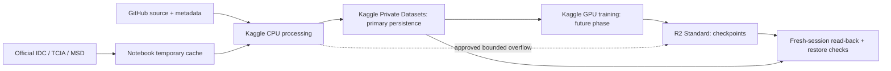

# P1-R.1 — Hybrid Cost-Optimized Architecture B

**APPROVED_ARCHITECTURE / FULL_CAPACITY_FEASIBILITY_NOT_YET_VERIFIED.** Người dùng chọn B trong lượt P1-R.1; giữ3datasets, SR production/XML immutable reference, Scarce–Vast và mọi annotation review. Bounded2sample Kaggle CPU conversion PASS theo [user evidence](evidence/p1_r_1/kaggle_native_review.json); exact approved input/result upload và27artifact new-notebook restore PASS theo [user-run evidence/attestation](evidence/p1_r_1/kaggle_session2_restore_user_verified.json). Actual account quota/privacy/version và full capacity chưa independently verified; real R2 remote pilot NOT_RUN. Không production infrastructure, full download, medical upload ngoài approval cụ thể, paid resource creation hoặc research training trong phase này.

## Vai trò và routing



| Artifact | Primary route | Điều kiện |
|---|---|---|
|Code/config/schema/portable receipts/reports|GitHub|Không medical pixels/raw XML, credentials hoặc user directory; chưa commit/push tự động|
|Current approved native data shards +annotation/provenance/QA|Kaggle Private Datasets|Exact destination/visibility/collaborators/license approval +actual quota +version-aware receipts|
|Original XML ZIP|Immutable reference trong primary persistent source namespace|17,304,054bytes/SHA256 pinned, preserve exact ZIP bytes nếu platform unpack; không per-batch duplicate|
|Original CT/RT/SR/MSD raw|Official providers +current local raw giữ nguyên; future retention/rehydration policy cần review|Không tự bỏ raw; official source không là backup guarantee. Phải source digest/UID/version và restore proof trước future policy|
|Checkpoints/full-state resume artifacts|R2 Standard qua boto3|Future training phase, currently synthetic pilot only; best/last/state retention budget chưa benchmark|
|Overflow shards|R2 Standard, chỉ khi user-approved và guard pass|Không tự spill medical data khi Kaggle đầy. Không dùng R2 để che full capacity gap|
|Decode/staging/retry/download cache|Temporary notebook/local cache|Không là durable archive; cleanup sau integrity+read-back+fresh-session restore và approval|

Kaggle CPU cho conversion, không GPU. Kaggle GPU dành research training tương lai; không khởi chạy trong P1-R.1. R2 SDK là Python boto3, không thay provider bằng lựa chọn khác.

## Budget intent và capacity gap

Thiết kế tại [hybrid_storage_budget.json](../configs/hybrid_storage_budget.json), decimal bytes:

- Chi phí ưu tiên **0VND/tháng**; contingency target **50,000VND/tháng**, **không phải spending authorization**.
- Kaggle primary target **180,000,000,000bytes**; remaining account quota phải đo thực, không giả định có đủ200GBpublished quota.
- R2 target **8,000,000,000bytes**, application hard limit ban đầu **10,000,000,000bytes**; pilot dừng ở8GBtarget, không tự dùng buffer2GB.
- Capacity của architecture target188GB thấp hơn conservative known plan553.60GB khoảng365.60GB. Raw-only theoretical floor≈160.11GB đã chiếm phần lớn180GBKaggle, còn khoảng19.89GBprimary cho derived/metadata/versions; R2 còn phải ưu tiên checkpoints. **Chưa chứng minh full pipeline cả3nguồn vừa budget.**

0.75–1TiB trong assessment cũ là capacity reference cho monolithic conservative plan, **không phải approved deployment/purchase recommendation của B**. Không tăng paid quota hoặc giảm dataset để xóa chênh lệch. Feasibility của B cần measured compressed native shards, version accounting, cache reuse và approved retention/rehydration policy qua pilot; nếu vẫn vượt thì ghi BLOCKED_CAPACITY, xin review phương án/budget riêng. Không chốt compression ratio từ10sample hoặc silently discard source/versions.

## R2 Standard pricing đã xác minh qua tài liệu

[Official Cloudflare pricing](https://developers.cloudflare.com/r2/pricing/), tra24/11/2026: Standard `$0.015/GB-month`, ClassA`$4.50/million`, ClassB`$0.36/million`, retrieval processing none và direct egress free. Free tier **10GB-month,1million ClassA,10million ClassB/tháng**, chỉ Standard; Infrequent Access không hưởng cùng free tier. Billing có rounding;412conditional writes cũng là ClassA operations.

8GBtarget có thể nằm trong free storage **nếu account còn headroom toàn billing month**; chưa xác minh current account usage. Application cap10GB hiện tại không là provider billing cap: GB-month dùng average daily peak, historical usage/other buckets/requests/retries/versions và billed units có thể khác current listing. Không hứa0VND hoặc50,000VND sẽ đủ mọi workload; FX/thuế/account terms chưa xác minh, không tự chuyển contingency thành quyền chi. Không tạo R2 subscription/bucket/billing setup ở lượt này.

## Storage Budget Guard design

Trước mọi future writes: pin account/billing period, quota snapshot time/trust level, provider used/remaining, managed bytes, pending/reserved bytes, stale stages, new version overhead và measured payload; unknown/stale data **BLOCKED**, không assume zero. Multi-writer production cần coordinator/lease+atomic reservation, không chỉ client-side list-before-put.

Kaggle gate: projected account usage và platform-transformed/version storage phải vừa actual remaining quota **và180GBtarget**; include saved notebook outputs limit riêng, không nhầm scratchfree với private quota. Nhập actual account snapshot có timestamp, không fake measurement bằng published limits. R2 gate: account-wide projected Standard bytes≤8GBtarget, hard10GB; multipart staging chưa account được thì stop. Approaching target yêu cầu review, không auto-route sang paid overflow hoặc cleanup.

Budget gồm storage+operation counters+transfer attempts+retention/checkpoint multiplicity+staging; request/cost month tách current capacity. Boto3/HTTP retry cũng tiêu quota. Chỉ bật paid work sau explicit user approval và cost estimate theo actual usage, không vì “còn50k dự phòng”. Guard ởphase này là **design plus bounded single-writer synthetic implementation**, chưa global transactional billing controller/Kaggle quota API/full scheduler.

## Minimal R2 pilot đã chuẩn bị

[r2_synthetic_pilot.py](../scripts/r2_synthetic_pilot.py): mặc định **offline plan**, generate1MiBsynthetic bytes (cap4MiB), không nhận medical input files. Real execution cần existing bucket, env/Secrets credentials và approval/headroom snapshot≤24h đúng billing month, exact target hash, single-writer attestation, zero paid-spend authorization và≥100free attempts/class.

Pilot list existing bucket/pending multipart, block unaccounted bytes, apply account estimate+listing guard, content-addressed key và `IfNoneMatch=*` create-only. [R2 conditional API](https://developers.cloudflare.com/r2/api/s3/conditional-operations/) hỗ trợ conditional PutObject;412 không bị retry overwrite, chỉ chấp nhận existing content sau actual read-back SHA. Cache hit reuse immutable payload, không upload duplicate. No deletes/provisioning/lifecycle API.

Bounded retry3attempts cho transient network/408/429/5xx, gồm body reads; auth/validation không retry. SDK retry tắt còn1attempt để tránh nhân retry; application đếm trước từng HTTPattempt,≤100/class. Đo wall/effective throughput cho successful synthetic put/get; ETag/metadata SHA không thay downloaded bytes SHA256. Ambiguous put/conditional conflict chỉ recover sau content verification, throughput upload có thể NOT_MEASURED khi reused.

**Actual R2 status:** boto3/credentials chưa được chuẩn bị trong verified pilot environment; real R2 upload/download/retry/throughput **NOT_RUN**.14fake-transport tests kiểm logic/corruption/retry/budget/Standard-only và ambiguous-put recovery; latest full suite263pass ([logs](evidence/p1_r_1/verification_restore_cell/verification.json)), không R2 network PASS. [Offline readiness](evidence/p1_r_1/r2_offline_plan.json) là snapshot trước native restore, giữ flags/runtime/kit digest, không secret values. R2 synthetic kit được chuẩn bị; Kaggle native restore đã có evidence riêng, full storage vẫn blocked.

## Thiết lập Secrets/environment và chạy sau review

Không hardcode key hoặc dán credentials vào notebook cell/output. Dùng Kaggle Secrets `R2_ACCOUNT_ID`, `R2_ACCESS_KEY_ID`, `R2_SECRET_ACCESS_KEY`, `R2_BUCKET`; key bucket-scoped tối thiểu quyền needed object read/write/list. Không cấp quản trị account/bucket creation; exact permissions cần kiểm thực trước execution.

```python
# Chạy bởi người dùng trong approved Kaggle notebook, không print secret values.
import os
from kaggle_secrets import UserSecretsClient
secrets = UserSecretsClient()
for name in ("R2_ACCOUNT_ID", "R2_ACCESS_KEY_ID", "R2_SECRET_ACCESS_KEY", "R2_BUCKET"):
    os.environ[name] = secrets.get_secret(name)
```

Local có thể dùng environment variables từ private secret store; không commit `.env`/approval runtime file. [Official boto3 example](https://developers.cloudflare.com/r2/examples/aws/boto3/) dùng account endpoint và region`auto`; script lấy từ env và không in endpoint/account/key. Credentials không đủ thì stop trước network. Không tìm credentials ở user filesystem hoặc tự tạo account.

Trong **pilot-only venv** cài `python -m pip install -r requirements-r2-pilot.txt`, `pip check`, freeze resolved versions; không sửa P0 lock. Real SDK/Linux compatibility và R2 APIs chưa test ở đây. Approval file private (ví dụ ignored `data/cache/r2_approval.json`) chứa các fields sau; giá trị phải từ user/dashboard, không copy placeholder thành verified facts:

R2 kit mới chưa có trong pinned production commit. Copy reviewed `scripts/r2_synthetic_pilot.py` và `requirements-r2-pilot.txt` vào separate code-kit root, giữ relative layout và kiểm SHA từ kit manifest; chạy các commands bên dưới từ kit root đó. Không giả định clone production SHA đã chứa script mới. Không cần copy medical input bundle cho R2 synthetic test.

```json
{
  "approved_synthetic_only": true,
  "single_writer_attested": true,
  "account_free_tier_headroom_attested": true,
  "verified_at_utc": "ACTUAL_UTC_ISO_TIMESTAMP",
  "billing_month_utc": "ACTUAL_YYYY-MM",
  "incremental_paid_spend_authorized_vnd": 0,
  "free_class_a_remaining": 100,
  "free_class_b_remaining": 100,
  "account_storage_estimate_bytes": 0,
  "target_id_sha256": "SHA256_OF_ACCOUNT_ID_COLON_BUCKET"
}
```

Số0usage/100remaining chỉ minh họa schema, **không measurement/default**. Kiểm actual account monthly GB-month/free operations, all-bucket usage, pending multipart và single writer trước xác nhận. Không log dashboard/API secrets. Target hash tính cục bộ từ env (không print input strings); approvals gắn đúngbucket nhưng shared reports chỉ giữ digest.

```python
import hashlib, os
target_id_sha256 = hashlib.sha256(
    (os.environ["R2_ACCOUNT_ID"] + ":" + os.environ["R2_BUCKET"]).encode()
).hexdigest()
# Ghi digest vào private approval JSON đã có actual headroom; không in credentials.
```

```bash
# Offline plan, không boto3 hoặc network cần thiết:
python scripts/r2_synthetic_pilot.py plan --output r2_plan_new.json
# Chỉ sau user review/headroom/target approval; existing R2 Standard bucket:
python scripts/r2_synthetic_pilot.py roundtrip --approval-file APPROVED_PRIVATE_JSON --output r2_session1_receipt.json
```

Reports create-only, failure giữ remote synthetic object nếu đã ghi, không tự cleanup. Lưu trusted SHA256 của session1receipt ngoài remote artifact không tin cậy, không suy ra từ receipt vừa restore. User có thể đặt private Kaggle metadata output làm receipt persistence sau approval; phải verify exact saved bytes.

## Hai notebook sessions và lifecycle

Session1: native kit ở [guide](cloud_pilot_guide.md) nếu approved sample transfer; synthetic R2 roundtrip riêng, record runtime, SDK freeze, attempts/time/throughput, receipt SHA. Không dùng synthetic test để claim medical/checkpoint restore pass. Chưa có checkpoints nghiên cứu thật ởphase này.

Kết thúc session1thật, mở session2CPU mới, attach approved private metadata receipt và load Secrets lại. Verify receipt externally pinned SHA rồi:

```bash
python scripts/r2_synthetic_pilot.py restore --approval-file APPROVED_PRIVATE_JSON \
  --receipt r2_session1_receipt.json --expected-receipt-sha256 TRUSTED_SESSION1_SHA \
  --fresh-session-attested --output r2_session2_restore.json
```

`R2_SYNTHETIC_CONTENT_VERIFIED` xác minh downloaded size/SHA; fresh-session attestation và Kaggle session/version evidence cần reviewer kiểm riêng, không tự là persistence PASS. Native arrays/geometry/annotation/provenance restore vẫn chạy native kit, không thay bằng synthetic payload. Real2session pilot hiện **NOT_RUN/BLOCKED_USER_ACTION**.

Lifecycle: one immutable source/object per digest, logical version refs không duplicate bytes khi backend cho phép; checkpoints giữ approved best/last/full-state policy trong8GBtarget, capacity overflow thì stop/review. Không delete old checkpoints/baselines/raw/XML, không automatic cleanup trong P1-R.1. Cleanup proposal sau này cần ownership, dry-run/hash receipts, independent read-back/restore và approval. Local/notebook cache là temporary, không reference source duy nhất. Dừng P1-R.1; không tự P1-R.2/full scheduler/training.
