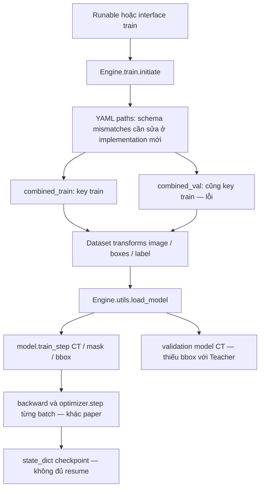

# Paper → source audit P0 / T01

## Nguồn và giới hạn bằng chứng

- Paper: Fredriksen et al. (2022), [PLOS ONE 17(4):e0266147](https://doi.org/10.1371/journal.pone.0266147), CC BY. Đã đọc Materials and methods (Data, Preprocessing, Teacher-student design, Algorithm 1, Implementation, Empirical evaluation), Results/Tables 2–5 và Discussion từ XML nguồn; đã xem trực tiếp Figure 2 PNG. Dùng section/figure/table làm vị trí tham chiếu, không giả page number từ PDF chưa render.
- Upstream: `https://github.com/VemundFredriksen/LungTumorMask`, pinned commit **`d1bca4b8dec8f3fe623b58d35be78055b954428c`**. Các path:line bên dưới là tại commit này; [permalink root](https://github.com/VemundFredriksen/LungTumorMask/tree/d1bca4b8dec8f3fe623b58d35be78055b954428c). Local clone `.reference/LungTumorMask/`, không sửa và không chạy training/inference upstream.
- Đọc thân code được ghi trong matrix, entry points, các model và preprocessing utilities; static search toàn bộ Python upstream với các từ khóa F1/precision/recall/DSC-TP/true-positive, resume, accumulation. Script audit hash 49 file Python trong `training/` và parse 47 YAML; số liệu/hashes/tables ở [upstream_audit.json](evidence/upstream_audit.json). MISSING/UNKNOWN là kết quả audit phạm vi này, không khẳng định code riêng của tác giả chưa từng tồn tại.
- `MATCH` = khớp phần mô tả đã kiểm; `PARTIAL` = chỉ một phần hoặc thiếu chứng cứ end-to-end; `DIFF` = khác trực tiếp; `MISSING` = không thấy implementation trong phạm vi search; `UNKNOWN` = chưa xác định. Các nhận xét dưới đây là **static observations**, không phải kết quả chạy source upstream.
- Không cài `setup.py` upstream: package inference pin legacy stack khác training. Logger ngoài máy xuất hiện trong utilities; không chạy, không sao chép endpoint/credential vào code mới.

## Ma trận đối chiếu

| Topic | Paper section / figure | Paper description | Upstream path:line / symbol | Observed behavior | Status | Planned handling | Validation/test | Priority |
|---|---|---|---|---|---|---|---|---|
| Entry point / registry | Implementation | Hai vai trò Teacher/Student | `training/Runable/Train/train_student.py:4`; `training/interface.py:53`; `training/Engine/utils.py:16`; `training/Networks/network.py:3` | Runable gọi `train.initiate`; factory thật ở `Engine.utils.load_model`, **không phải** base class `Networks/network.py` có hai method `pass` | PARTIAL | Factory/config mới typed; không xem tên file là registry | Kiểm model contracts ở T12 | P0 |
| Config schema | Implementation | Config cần đủ để train | `training/Engine/train.py:140`; `training/Engine/utils.py:22`; `training/Resources/Student_Train/train.yaml:4` | Loader lặp qua `train_dataset` như list nhưng config là string; factory đọc `filters` vô điều kiện nhưng config UNet4 không có. `train.batch_size` cũng thiếu | DIFF | Không dùng YAML này như resolved config chạy được; giữ reference tách riêng | P0 strict-config tests; training schema T10 | P0 |
| Strong/validation split | Empirical evaluation | Train/val/test riêng theo bệnh nhân | `training/Engine/train.py:143`; `training/Engine/train.py:153`; `training/Engine/train.py:156` | Cả `combined_train` và `combined_val` đọc key **`train`**; validation không dùng key `val` | DIFF | Viết loader từ frozen manifests mới; không tái sử dụng loop này | Patient/case/hash disjoint checks T07 | P0 |
| Exact split / scarce weak pool | Empirical evaluation; Discussion | Vast khoảng 500/750, Scarce khoảng 50/1000; Discussion nói 40 strong | `training/Resources/Student_Train/data.yaml`; `training/Resources/Idun_Train_2/data.yaml`; `training/Engine/train.py:143` | YAML có `train=49`, `train2=541`, `val=5`, `val2=26`; loader chỉ dùng `train`. Không có bằng chứng ánh xạ key 2 vào experiment hay quy tắc tạo weak pool | UNKNOWN | Adapted protocol 40 train + 20 val đã được duyệt; không suy diễn strong còn lại chuyển weak | T07 inventory/mapping thật, không tính crop như patient | P1 |
| Additional split configs | Empirical evaluation | Test cố định ~15% | `training/Resources/Idun_Train_1/cropped.yaml`; `training/Resources/Idun_Train_2/lungdx_data.yaml`; `training/Resources/Student_Train/data_test.yaml` | List lengths lần lượt 55/7, weak 589/23/27. `Student_Train/data_test.yaml` không parse được (vị trí lỗi trong audit JSON). Không thể nhận đây là exact paper split | PARTIAL | Khóa split mới sau QC; ghi deviations | Parse/list counts audit đã chạy, patient mapping chưa chạy | P1 |
| Intensity | Preprocessing | Clip [-1024,1000], Z-score | `training/Utils/crop.py:17`; `training/Utils/crop_lungs.py:113`; `lungtumormask/dataprocessing.py:99` | Có clip và `NormalizeIntensityd`; scope/defaults phụ thuộc MONAI version. Lung crop normalize trước resample; teacher utility normalize sau resample | PARTIAL | Chốt thứ tự/scope rõ, kiểm legacy defaults trước claim equivalence | Synthetic constant-volume/normalization T08 | P1 |
| Spacing / label interpolation | Preprocessing | 1×1×1.5 mm, label cùng grid | `training/Utils/crop.py:23`; `training/Utils/crop_lungs.py:121`; `training/Utils/crop_lungs.py:131` | Teacher utility dùng **0.7³ mm**, không phải paper; lung utility resample image rồi resize labels/boxes và threshold; không chỉ định nearest-neighbor một cách rõ ràng | DIFF | Physical resample CT và NN labels, preserve metadata; 1×1×1.5 là paper reference | World-coordinate and round-trip tests T08 | P1 |
| Teacher crop / inverse | Preprocessing | 128³ quanh tumor | `training/Utils/crop.py:42`; `:54`; `:126`; `:137`; `:173` | Crop bbox center 128³, có pickle reference và relocate; slicing âm không xử lý clipping đầy đủ; crop affine chưa dịch origin; relocate dùng `save_folder` không phải parameter `store_folder` | PARTIAL | Crop/pad bounds explicit và affine transform chain mới; không import utility | Edge/padding/affine round-trip tests T08 | P1 |
| Axial bbox from strong masks | Data; Algorithm 1 | Bbox 2D từng axial slice | `training/Utils/segment_to_segmentbox.py:28`; `:36`; `:39`; `:24` | Per-slice min/max fill theo foreground; tất cả foreground trong slice chung một box; NIfTI writer dùng identity affine thay original affine | PARTIAL | Giữ semantics axial, explicit object policy/inclusive bounds; preserve geometry | Bbox encloses foreground, multilesion + affine tests T08 | P1 |
| Weak XML/UID conversion | Data | CT-only và bbox axial | `training/Utils/PETCT_LungDx_utilities.py:60`; `:75`; `:79`; `:100`; `:111` | Source parser đọc XML, map theo SOPInstanceUID; lấy **box đầu tiên**, convert one-based min inclusive → slicing; lỗi parse trả zeros | PARTIAL | XML là evidence về source cũ, chưa xác nhận bản tải hiện tại; kiểm multiple boxes/class/coverage; quarantine lỗi | Sample annotation + slice overlay T06 | P1 |
| Weak CT geometry/length filter | Data | Loại non-CT, extent Z ngoài [16,60] cm | `training/Utils/PETCT_LungDx_utilities.py:11`; `:19`; `:31`; `:39`; `:50`; `:54`; `:97` | N×thickness/10, glob không sort hình học rồi reverse, affine không dùng ImageOrientationPatient. Image filter strict 16<Z<60, bbox filter strict **20<Z<60** | DIFF | DICOM series/UID đúng, geometry-based extent; cùng filter CT+bbox; không ép count=665 | Oblique/shuffled slices/extent/paired output tests T06 | P1 |
| NSCLC GT conversion | Data | Strong segmentation | `training/Utils/radiomics_formatting.py:8`; `:25`; `:33` | Có dcmrtstruct2nii và chọn `GTV-1`; chọn CT bằng số file, chưa check referenced series UID | PARTIAL | Verify primary ROI + referenced CT series, fail/quarantine rõ | RTSTRUCT overlay và ROI provenance T05 | P1 |
| Student lung crop | Preprocessing | Crop từng phổi bằng lungmask | `training/Utils/crop_lungs.py:24`; `:111`; `:126`; `:134`; `:155` | R231 tạo lung mask, crop hai phía, pad k=16; **loại crop nếu GT label rỗng**; train path yêu cầu image/label/boxes | PARTIAL | Baseline/SO chung CT-only ROI; không dùng GT để cứu crop test; kiểm bias bỏ negative lung | CT-only test + peripheral tumors T08 | P1 |
| Published CT-only inverse/merge | Teacher-student design; Preprocessing | Student automatic CT→mask | `lungtumormask/dataprocessing.py:129`; `:206`; `:216`; `:222`; `:237`; `lungtumormask/mask.py:18` | Package inference có lung ROI, unpad/resize/stitch, max merge, optional lung filter và morphology; không cần tumor GT/bbox. Unpad suy từ intensity thay metadata. Không đồng nhất với training engine | PARTIAL | Tham chiếu luồng, viết inverse từ metadata explicit; chưa chạy model/weights này | Full-volume CT-only/affine tests P1+ | P1 |
| Teacher input/blocks | Fig2; Implementation | Bbox-guided; 3 downsamplings; stride conv + PReLU | `training/Networks/UNet5_Teacher.py:10`; `:49`; `:56`; `:80`; `training/Networks/UNet5_filter_teacher.py:10`; `training/Networks/UNet5_decoder_teacher.py:10` | Variants concat CT+bbox → 2 channels hoặc bbox features từng level; đều có 4 MaxPool và LeakyReLU. `UNet5_Teacher` không có trong factory; validation generic gọi thiếu bbox | DIFF | Chưa chọn variant paper; conditioning cần quyết định dựa nguồn và shape tests. Không đưa model legacy vào core như exact reproduction | Teacher [N,1,D,H,W]+bbox→[N,1,D,H,W] T12 | P0 |
| UNet4 Student candidate | Fig2; Implementation | 4 stride-conv downsamplings, PReLU, instance norm | `training/Networks/UNet4.py:43`; `:53`; `:63`; `:73`; `:114` | UNet4 có **3 MaxPool**, BatchNorm, LeakyReLU, output sigmoid; khác Fig2 dù sample YAML gọi UNet4 | DIFF | Không lấy sample YAML làm kiến trúc paper; resolve trước E01 | Depth/activation/shape test T10 | P0 |
| MONAI SO candidate | Fig2 | 4 stages 64/128/256/512 sau stride conv | `training/Networks/monai_unet.py:11`; `:22`; `:58`; `:94`; `:153`; `training/Resources/Idun_Train_2/train_us.yaml:17` | Có InstanceNorm/PReLU, stride conv, sigmoid. List 4 channels của train_us tạo **3 strides**; inference release ở `lungtumormask/mask.py:12` dùng 5 channels, 4 strides và 1024 bottom. Chưa có cấu hình duy nhất khớp toàn bộ hình | PARTIAL | MONAI là candidate về blocks; không mặc định exact channels/depth. Smoke nhỏ hoàn toàn riêng | Resolve full model config T10/T12 | P0 |
| DO outputs / loss | Fig2; Implementation | Segmentation + bbox decoder, hai losses | `training/Networks/monai_student.py:68`; `:150`; `:153`; `:158`; `training/Networks/UNet_concat_double_student.py:23` | MONAI DO train concat hai outputs/targets rồi DiceLoss chung; eval semantic branch. Variant concat student trả tổng hai losses; không tự coi hai reduction tương đương | PARTIAL | Optional P5, explicit per-branch weighting/reduction | Loss/branch/CT-only contract tests T21 | P5 |
| Dice activation | Implementation | Dice Loss, chọn lowest validation loss | `training/Engine/utils.py:46`; `training/Networks/UNet4.py:114`; `training/Networks/monai_unet.py:72`; `training/Engine/train.py:124` | Source model sigmoid rồi `DiceLoss()` defaults. P0 fixture trả logits và dùng `DiceLoss(sigmoid=True)` explicit | PARTIAL | Xác minh defaults MONAI 0.4 trước implementation loss nghiên cứu; không sigmoid hai lần | Loss/empty-target tests T09/T10; fixture finite test P0 đã có | P0 |
| LR / max epochs | Implementation | Adam 1e-4, max350/convergence | `training/Resources/Student_Train/train.yaml:19`; `:22`; `training/Resources/Idun_Train_2/train_us.yaml:20`; `:23` | Sample Student LR2.5e-5/max500; train_us LR5e-5/max5000 | DIFF | Paper/reference/runtime tách riêng; không claim paper reproduction từ sample | Resolved config logged per run | P0 |
| Gradient accumulation | Implementation | Microbatch1, accumulated8 | `training/Engine/train.py:50`; `:68`; `:69`; `:80`; `:184` | `zero_grad` chỉ gọi trước toàn bộ loop; optimizer.step **mỗi microbatch**; `batch_size` chỉ chia log loss. Không phải accumulation8, còn giữ gradient từ update cũ | DIFF | Viết training loop mới, zero/scale/step đúng boundary, handle tail batch | Count steps + effective-batch equivalence T10 | P0 |
| Checkpoint/resume | Không đủ chi tiết ở paper; yêu cầu nhóm | Người dùng cần nhiều session một run | `training/Engine/train.py:61`; `:126`; `:132`; `:196` | Lưu `model.state_dict()`; load weights; không thấy optimizer/RNG/epoch/scheduler/AMP resume | MISSING | Full checkpoint contract ở handoff; P0 chưa hiện thực production resume | 10 vs5+save/load+5, corrupt/mismatch tests T10 | P2 |
| Pseudo-generation end-to-end | Algorithm1 | Teacher dự đoán CT+bbox→pseudo, Student học hợp strong+pseudo | `training/Engine/inference.py:27`; `:29`; `:50`; `:60`; `:70`; `training/Runable/Inference/inference.py:4` | Inference load boxes nhưng gọi `model(inp)` không bbox; key `test` vs `data` bất nhất; Logger chưa định nghĩa. Utility relocate có nhưng không thấy pipeline Teacher→provenance→Student chạy hoàn chỉnh | PARTIAL | Viết pseudo job frozen teacher + geometry/provenance, idempotent ở T14; không lấy bbox làm mask | Synthetic pseudo/inverse, label-source checks T14 | P3 |
| Strong/pseudo sampler / size balancing | Empirical evaluation | Upsample rare tumor sizes train/val | `training/Engine/train.py:143`; `:184`; `training/Utils/volume_histogram.py` | Generic loader shuffle, không có source ratio/weighted sampler; histogram utility không chứng minh balancing. `train2/val2` không được dùng | MISSING | Chốt sampler trước training, label provenance, validation unique-cases | Source counts/sample distribution T10/T16 | P2 |
| DSC evaluation | Empirical evaluation | DSC per case/source, object-wise metrics | `training/Engine/evaluate.py:40`; `:57`; `:61`; `:66` | Threshold + **largest connected component** rồi compute_meandice; generic eval không bbox; train metric thêm unsqueeze(0) cả output/label | PARTIAL | Metric full volume, explicit postprocessing/axes, Teacher conditional riêng | Hand-calculated fixtures T09 | P2 |
| DSC-TP / F1 ≥25% | Empirical evaluation | TP nếu overlap≥25% | Search toàn bộ `*.py`; `training/Engine/evaluate.py:34` | Không thấy object matching/overlap denominator/DSC-TP/F1 trong Python source; engine chỉ có mean Dice | MISSING | Viết metric spec riêng, không đồng nhất overlap với IoU; ghi adaptation | 25% boundary, split/merge/empty matching T09 | P2 |

## Luồng và shape đã truy vết

Tensor trong source: MONAI `AddChanneld` tạo `[C,X,Y,Z]` từ NIfTI array; DataLoader batch1 → `[1,1,X,Y,Z]`. Conv3d xem ba trục này là spatial tensor axes, không chứng minh đó là physical `(D,H,W)`. Phải định nghĩa hoán vị rõ trong implementation mới.

- Legacy concat Teacher: image và bbox `[N,1,a,b,c]` → concat `[N,2,a,b,c]` → sigmoid mask `[N,1,a,b,c]`, bốn downsamplings (đọc source, chưa shape-test).
- SO MONAI: CT `[N,1,a,b,c]` → sigmoid mask cùng shape, số stride bằng len(channels)−1. DO `forward_train` → `[N,2,a,b,c]`, inference `forward` chỉ semantic channel.
- Published inference: CT NIfTI → lungmask R231 → ROI trái/phải → normalize/crop/spacing/pad16 → student → inverse resize/stitch → `max(left,right)` → original affine. Luồng chỉ CT đã đọc được; chưa chạy weights hay xác minh round-trip.
- P0 fixture thực chạy: logits `[1,1,16,16,16]` → DiceLoss(sigmoid=True) với binary target cùng shape → backward/Adam; không dùng bất kỳ patient data nào.

## Kết luận config / kết quả paper

Giữ paper hyperparameters trong `configs/references/paper.yaml`, repo sample trong `configs/references/upstream.yaml`, runtime smoke trong `configs/smoke.yaml`. Chưa tạo resolved config E01/E02/E03: chưa có data, model paper chưa resolve, resource GPU chưa profile. Không chạy source gốc chỉ để bỏ qua những lỗi audit phát hiện.

Đã đối chiếu Tables 2–5 từ XML: bảng DSC trong handoff khớp các mean tương ứng. Table 5 ghi MSD Scarce SO=64.74, DO=71.00, baseline=26.45. Prose nói SO cao nhất mâu thuẫn Table 5; ưu tiên bảng và ghi chú. Correction 2024 chỉ Funding, không sửa chỗ này. Đây là số của tác giả, **không phải số nhóm**. XML raw và Fig2 PNG được giữ ở `.reference/paper/`; audit JSON lưu hash và attribution.

## Các điểm còn mở và thứ tự xử lý

1. P1/T04–T06: dataset licenses/version/access; CT/RTSTRUCT UID và ROI; weak XML/format thực, multi-box, missing-vs-negative, geometry và extent nhất quán. Có raw sample mới kết luận được nhãn hợp lệ.
2. T07: khóa adapted patient splits theo 40 train +20 val đã được duyệt; test~15% mỗi nguồn strong; không cố tái dựng số paper từ YAML không đủ provenance.
3. T08: transform/crop round-trip, lungmask failure policy không dùng GT test; mask/pseudo coverage phải hợp lệ trước training.
4. T09/T10/T12: model contracts, activation/loss defaults, sampler và object metrics; training loop/resume mới có tests. Giữ câu hỏi OPEN nếu source không đủ.
5. T14+: pseudo generation có provenance và QA thật. Tài liệu audit hoàn thành không đồng nghĩa pipeline nghiên cứu đã hoàn thành.

## Cập nhật T05 — 24/11/2026

Upstream loader chọn GTV-1 nhưng thiếu referenced-series/FoR validation. Implementation riêng tại `src/lungseg/data/dicom_geometry.py`, `rtstruct.py`, `nsclc.py` kiểm exact study/series/frame/image UIDs, physical slice positions, LUT/rescale và contour semantics trước conversion. Đây là inventory/conversion đã kiểm sample thực, không copy loader upstream hoặc coi đã tái hiện training pipeline paper. Survey10RT:9GTV-1 với varied numbers/generic ORGAN tags;7pairs converted,3quarantine,002 review. Xem [QA report](nsclc_qa_report.md). O06 chỉ resolve trên sample; full corpus BLOCKED_STORAGE, chưa T06–T08/model research.
